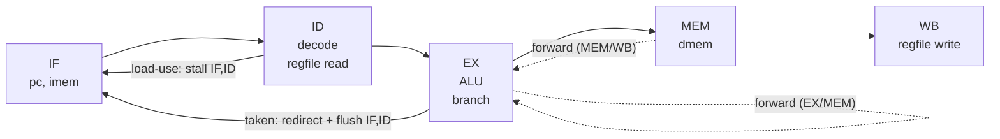

# The Classic Five-Stage Pipeline (RV32I)

**Topic:** Appendix C (Pipelining) · **Editions:** the pipeline appears in all seven (main chapter in the
1st-2nd, appendix from the 3rd); RISC-V is the teaching ISA of the 6th-7th ·
**Files:** [`sv/rv32i_pipeline.sv`](sv/rv32i_pipeline.sv), [`vhdl/rv32i_pipeline.vhd`](vhdl/rv32i_pipeline.vhd)
(plus `rv32i_pkg` in each language)

## Background

Pipelining overlaps the execution of instructions the way an assembly line overlaps cars. Splitting an
instruction into five stages lets a new instruction start every cycle:

| Stage | Work |
|-------|------|
| **IF**  | fetch the instruction at `pc` |
| **ID**  | decode, read registers, sign-extend the immediate |
| **EX**  | ALU operation, effective address, branch decision |
| **MEM** | load or store |
| **WB**  | write the result to the register file |

With no hazards the ideal CPI is 1. Real pipelines lose cycles to **hazards**:

```
Pipeline CPI = Ideal CPI + Structural stalls + Data-hazard stalls + Control stalls
```

This design handles each class as follows:

| Hazard | Example | Resolution |
|--------|---------|------------|
| Data, distance 1 | `add x3,x1,x2` ; `sub x4,x3,x1` | **forward** EX/MEM result into EX |
| Data, distance 2 | result in MEM/WB | **forward** MEM/WB result into EX |
| Data, distance 3 | result in WB | register file is **write-through** (a read in the same cycle sees the write) |
| Load-use | `lw x5,0(x0)` ; `add x6,x5,x5` | data not available until after MEM: **stall one cycle**, then forward |
| Control | taken `beq`/`bne`/`blt`, `jal`, `jalr` | resolved in EX with a **predict-not-taken** policy; the two wrong-path instructions behind are **flushed** (2-cycle penalty) |



## Design

* **ISA subset (RV32I):** `add sub and or xor slt sll srl`, `addi andi ori xori slti slli srli`, `lui`,
  `lw sw`, `beq bne blt`, `jal jalr`, and `ebreak`, which the testbench uses as a halt marker.
* **Memories** are external, combinational-read, single-cycle models (the textbook assumes a perfect memory
  here; see [`set_assoc_cache`](../../ch02_memory_hierarchy/set_assoc_cache) for a realistic one).
* **Valid bits** travel with each stage, so a bubble is just an instruction whose control bits are all zero.
* **Statistics** (`stat_cycles`, `stat_retired`, `stat_load_stalls`, `stat_flushes`) freeze when `ebreak`
  retires, which makes the CPI formula directly testable.
* A **debug read port** (`dbg_raddr/dbg_rdata`) on the register file lets a testbench inspect results
  without hierarchical references (portable across Icarus and GHDL).

## Verification

The testbench carries a tiny **assembler written as functions** (so there are no external hex files) and
runs this 25-instruction program:

| Words | Code | Exercises |
|-------|------|-----------|
| 0-3  | `addi x1,x0,5` `addi x2,x0,7` `add x3,x1,x2` `sub x4,x3,x1` | both forwarding paths |
| 4-6  | `sw x3,0(x0)` `lw x5,0(x0)` `add x6,x5,x5` | load-use stall (exactly 1) |
| 7-8  | `beq x6,x6,+8` then `addi x7,x0,99` | taken branch; the wrong-path write to `x7` must **not** happen |
| 9-14 | `addi x8,x0,1`, loop `add x11,x11,x10` / `addi x10,x10,-1` / `bne x10,x0,-8` | 10-iteration loop, 9 taken branches |
| 15-18 | `sw x11,4(x0)` `jal x12,+8` `addi x13,x0,77` `slt x14,x0,x11` | `jal` link value, wrong-path squash |
| 19-24 | `lui` `addi` `slli` `jalr x18,x0,96` `addi x19,x0,55` `ebreak` | `lui`, shifts, `jalr`, halt |

Final register values, both memory words (`12`, `55`), and the squashed registers (`x7`, `x13`, `x19` = 0)
are all checked. The performance counters must satisfy the textbook model exactly:

```
retired          = 49
load-use stalls  =  1
taken transfers  = 12   (1 beq + 9 bne + 1 jal + 1 jalr)
cycles = retired + 4 (pipeline fill) + stalls + 2 x taken = 49 + 4 + 1 + 24 = 78
CPI    = 78 / 49 = 1.59
```

Both languages finish at exactly 828 ns.

## Run it

```bash
make test T=rv32i_pipeline
```

## Exercises

1. Move branch resolution from EX to ID (add a comparator and forwarding there) and recompute the CPI.
2. Add a simple branch predictor from [`ch03_ilp/branch_predictor`](../../ch03_ilp/branch_predictor) so that
   correctly predicted taken branches cost 0 cycles.
3. Add `lb/lh/sb/sh` and the remaining branches (`bge`, `bltu`, `bgeu`).
4. Remove the forwarding paths one at a time and report the new CPI -- this reproduces the book's
   "cost of not forwarding" analysis.
