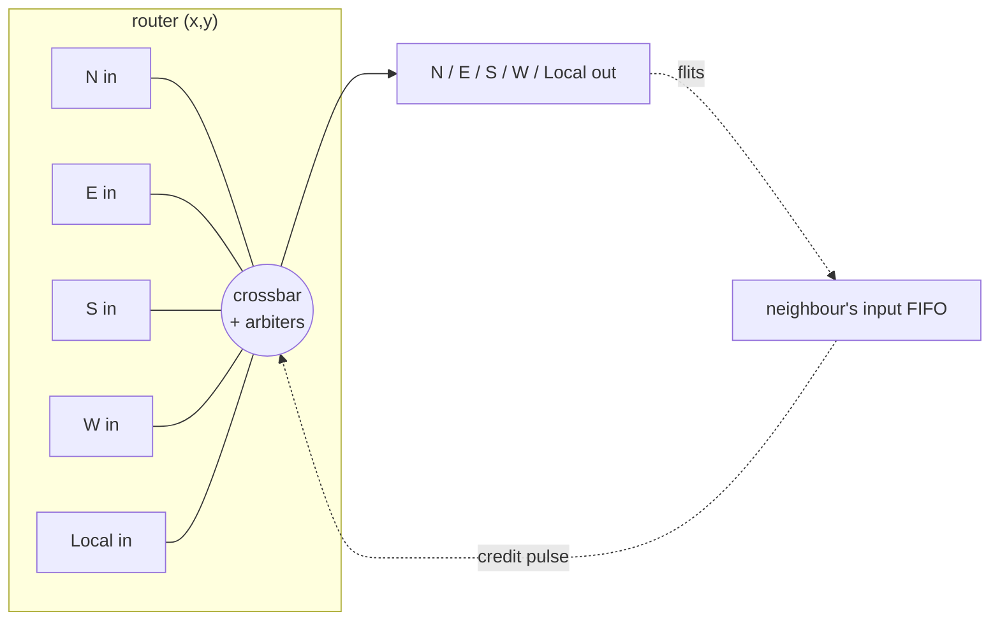

# Wormhole Mesh Router and 2-D Mesh Network

**Topic:** Appendix F (Interconnection Networks) · **Editions:** interconnection networks from the 2nd edition (as an appendix in the later ones) ·
**Files:** [`sv/mesh_router.sv`](sv/mesh_router.sv), [`sv/mesh_net.sv`](sv/mesh_net.sv), [`sv/mesh_pkg.sv`](sv/mesh_pkg.sv) and the same three in [`vhdl/`](vhdl)

## Background

A network is described by its **topology**, **routing**, **flow control** and **switching** policy. A 2-D **mesh** is the workhorse topology of on-chip networks: each node connects to its four neighbours, wiring
is short and regular, and the diameter of a `k x k` mesh is `2(k-1)` hops.

* **Routing.** *Dimension-order (XY) routing* sends a packet along X until it is in the destination column, then along Y. It is minimal, needs no routing tables, and is **deadlock-free** on a mesh: a
  cyclic wait would need a packet to turn from Y back into X, which XY never does.
* **Switching.** *Store-and-forward* buffers a whole packet at every hop. *Wormhole* switching splits a packet into **flits** and forwards the head as soon as the route is known, the body trailing behind it like
  a worm; buffers need hold only a few flits, but a blocked head stalls the whole worm, which keeps the links it occupies.
* **Flow control.** Without a back-pressure mechanism buffers overflow. In **credit-based** flow control each sender tracks the number of free slots in the receiver's buffer, spends a credit per flit and
  gets it back when the receiver forwards the flit on. The buffer must cover the **bandwidth x round-trip** product of the credit loop, otherwise the link idles waiting for credits.
* **Arbitration.** When several packets want the same output, a fair arbiter (here round-robin) picks one.

## Design

`mesh_router` has five ports (North, East, South, West, Local), each with an input FIFO (`DEPTH` flits, default 4):

* **Flits** are 34 bits: a 2-bit type (body / head / tail / single), a 16-bit packet id, an 8-bit flit index and, in head flits, the destination `(x, y)`.
* **Routing** (head flit at the front of a FIFO): `dest_x > X` -> East, `< X` -> West; else `dest_y > Y` -> South, `< Y` -> North; else Local (eject).
* **Wormhole lock.** A head flit that wins an idle output *locks* that output to its input; the lock is released when the tail is forwarded. Body flits then follow without arbitration, and flits of
  different packets never interleave on a link. A single-flit packet takes no lock.
* **Credits.** Every non-local output has a counter initialised to `DEPTH`. Forwarding a flit needs a credit and decrements it; a one-cycle pulse from the downstream router when it pops the flit increments it.
  An `err_overflow` flag would catch any violation.
* **Arbitration.** An idle output picks, round-robin, among inputs whose head flit is a head routed to it.
* **Timing.** A flit written to an input FIFO at the end of cycle *c* is switched into the output register at the end of *c+1* and is on the output link in *c+2*: **2 cycles per router**.

`mesh_net` instantiates an `NX x NY` grid, wires each output to the neighbour's matching input (and credits back the opposite way), ties the edges off, and exposes one injection and one ejection port per node.



## Verification

* **Routing table.** A single router at `(1,1)` of a 3x3 mesh is driven with one-flit packets: 14 (input port, destination) combinations, checking exactly one output goes valid, it is the right one, and the flit is intact.
  Crucially it checks **X before Y**: a flit for `(2,0)` from `(1,1)` must go **East**, not North, and one for `(0,2)` must go **West**. (Routing Y first makes exactly these cases fail.)
* **Zero-load latency**, derived by hand: a packet crossing `K` routers (`hops + 1`) with `F` flits takes `2K + F - 1` cycles from the head on the injection link to the tail on the ejection link.

  | Packet | `K` | `F` | Latency (asserted) |
  |---|--:|--:|--:|
  | `(0,0) -> (3,3)` | 7 | 5 | **18** |
  | `(0,0) -> (1,0)` | 2 | 1 | **4** |
  | node to itself | 1 | 3 | **4** |
  | `(3,0) -> (0,2)` | 6 | 2 | **13** |
* **The credit loop.** A credit's round trip is *decision -> downstream pop -> credit pulse -> counter update -> next decision* = **4 cycles**, so the input FIFO needs **4 slots** to sustain one flit per cycle (the buffer
  must hold a bandwidth-delay product). A single 40-flit packet over four routers should take `2 x 4 + 39 = 47` cycles at full rate:

  | FIFO depth | 2 | 3 | **4** | 5 |
  |---|--:|--:|--:|--:|
  | latency (cycles) | 85 | 60 | **47** | 47 |
  | link rate | ~1/2 | ~3/4 | 1 | 1 |

  Depth 4 and 5 hit the ideal 47 exactly; shallower buffers throttle the link by about `depth / 4`, and the test requires `85 > 60 > 47`.
* **Hot spot.** All 15 other nodes send a 4-flit packet to node `(0,0)` simultaneously: all are delivered, and the 60 flits leave through the single ejection port in **exactly 60 consecutive cycles** (arbitration and the
  wormhole locks leave no bubbles); the worst-off packet waits 63 cycles.
* **Random traffic.** 128 packets (16 nodes x 8, 1-6 flits, random destinations and start times) all arrive: right destination, flits in order, packets never interleaved, each delivered exactly once, with the full
  length, no input FIFO overflow, and no deadlock. Every packet's latency is at least its zero-load bound; the average is **11.43 cycles against 9.41 at zero load** (contention factor 1.21).

Ignoring the credit check (so FIFOs overflow) is also caught. Both languages produce identical numbers.

## Run it

```bash
make test T=mesh_router
```

## Exercises

1. Add **virtual channels** (two FIFOs per input sharing a physical link) and show that a blocked packet no longer stalls an unrelated one behind it (head-of-line blocking).
2. Switch to **YX routing** or **west-first** adaptive routing and compare the random-traffic latency; explain which turn restrictions keep each deadlock-free.
3. Make the router a **single-cycle** design (route and switch in one stage) and recompute the zero-load and credit-loop formulas.
4. Replace the mesh by a **torus** (wrap-around links): what breaks (deadlock) and what do you need (a second virtual channel with dateline routing)?
5. Compare the 16-node mesh with the single crossbar [`rr_crossbar`](../rr_crossbar) in latency under the hot-spot pattern and in wiring/area.
