# Set-Associative Write-Back Cache

**Topic:** Chapter 2 / Appendix B (Memory Hierarchy) · **Editions:** 1-7 ·
**Files:** [`sv/set_assoc_cache.sv`](sv/set_assoc_cache.sv), [`vhdl/set_assoc_cache.vhd`](vhdl/set_assoc_cache.vhd)

## Background

A cache exploits **temporal** and **spatial locality** by keeping recently used blocks in a small, fast
memory. The textbook's four design questions all have concrete answers in this module:

| Question | Choice here |
|----------|-------------|
| Where can a block be placed? | *n*-way set associative (`WAYS`); `WAYS = 1` is direct mapped |
| How is a block found? | the address is split into tag / index / word offset; the tags of the indexed set are compared in parallel |
| Which block is replaced on a miss? | true **LRU** (age counters per way); invalid ways are used first |
| What happens on a write? | **write-back, write-allocate**: writes stay in the cache and mark the line dirty; a dirty victim is written to memory only when evicted |

```
 ADDR_W-1                                   BYTE_W  0
 +-----------+--------------+---------------+-------+
 |    tag    |  set index   |  word offset  | byte  |
 +-----------+--------------+---------------+-------+
```

The performance metric is **average memory access time**:

```
AMAT = hit_time + miss_rate x miss_penalty
```

The module exposes `stat_hits`, `stat_misses` and `stat_writebacks` so a testbench (or an exercise) can
measure the miss rate directly.

## Design

Parameters: `SETS`, `WAYS`, `LINE_WORDS`, `ADDR_W`, `DATA_W` (powers of two; `SETS >= 2`, `LINE_WORDS >= 2`).
The default is 4 sets x 2 ways x 4 words = 128 bytes.

```mermaid
stateDiagram-v2
    [*] --> IDLE
    IDLE --> IDLE: hit (served this cycle)
    IDLE --> WRITEBACK: miss, victim valid and dirty
    IDLE --> REFILL: miss, victim clean or invalid
    WRITEBACK --> REFILL: mem_done
    REFILL --> IDLE: mem_done (line installed; request then hits)
```



* **CPU port.** `req_valid/req_we/req_addr/req_wdata` are held stable until `resp_valid` is high. On a hit
  `resp_valid` and `resp_rdata` are combinational, so a hit completes in the cycle it is presented.
* **Memory port.** Whole-line transfers: `mem_valid` stays high (with `mem_we`, `mem_addr`, `mem_wdata`)
  until the memory pulses `mem_done`; refill data arrives on `mem_rdata`.
* A miss never answers directly: after the refill the same request is simply replayed and hits. This keeps
  the hit path and the miss path identical, at the cost of one extra cycle per miss.
* **Storage** is flattened into 1-D arrays indexed `set*WAYS + way` so both Icarus and GHDL handle it.

## Verification

The testbench models main memory with a 3-cycle latency and runs this access sequence on a 4x2x4 cache
(word *w* maps to set `(w/4) mod 4`, tag `w/16`; words 0, 16 and 32 collide in set 0):

| # | Access | Outcome | hits / misses / write-backs |
|---|--------|---------|-----------------------------|
| 1 | read 0 | cold miss | 0 / 1 / 0 |
| 2 | read 1, read 3 | hits (spatial locality) | 2 / 1 / 0 |
| 3 | read 4 | miss, next set | 2 / 2 / 0 |
| 4 | write 0, read 0 | hits; line now dirty | 4 / 2 / 0 |
| 5 | read 16, read 32 | two misses; line 0 (LRU, dirty) is **evicted and written back** | 4 / 4 / 1 |
| 6 | read 0 | miss; refill returns the written-back value `DEADBEEF` | 4 / 5 / 1 |
| 7 | read 16 | miss; evicts clean line 32, no write-back | 4 / 6 / 1 |

It also checks that main memory really contains `DEADBEEF` after the eviction. Both languages end the
simulation at exactly 560 ns.

## Run it

```bash
make test T=set_assoc_cache
```

## Exercises

1. Instantiate `WAYS = 1` and re-run the trace: how many more misses does the direct-mapped cache take
   (conflict misses)?
2. Add a **victim cache** (a small fully-associative buffer of recently evicted lines) and measure its effect.
3. Make the cache non-blocking: allow hits while a refill is outstanding (hit-under-miss).
4. Replace LRU with random or pseudo-LRU (tree) replacement and compare miss counts on a looping access pattern.
