# TLB and Hardware Page-Table Walker

**Topic:** Chapter 2 / Appendix B (virtual memory and address translation) · **Editions:** 1-7 ·
**Files:** [`sv/tlb_walker.sv`](sv/tlb_walker.sv), [`vhdl/tlb_walker.vhd`](vhdl/tlb_walker.vhd)

## Background

**Virtual memory** gives each program its own address space, protects programs from one another, and lets a program use more
memory than is physically present. The hardware translates every **virtual address** to a **physical address** through a
**page table** in memory:

```
 virtual address   |  virtual page number (VPN)  |  page offset  |        4 KB pages: 12-bit offset
                              |  page table lookup                           |
 physical address  |  physical page number (PPN) |  page offset  |
```

Walking the page table costs a memory access per level, and *every* load, store and instruction fetch needs a translation. The
fix is yet another cache -- the **translation lookaside buffer (TLB)** -- holding recent VPN -> PPN mappings. TLBs are small and
fully (or highly) associative, so they are fast and rarely miss. A miss is handled by the **page-table walker**, in hardware or in
software; a missing page (valid bit clear) raises a **page fault** for the operating system, and a write to a read-only page raises
a **protection fault**.

```
AMAT with translation = TLB hit time + TLB miss rate x walk time + (cache AMAT)
TLB reach = entries x page size            (4 entries x 4 KB = 16 KB here)
```

## Design

* Fully-associative, `ENTRIES = 4` (power of two), **true LRU** (age counters, as in
  [`set_assoc_cache`](../set_assoc_cache)); invalid entries are filled first.
* One-level page table at `PT_BASE`; the PTE for page *v* is the word at `PT_BASE + 4v`:

  ```
  PTE[31:12] = physical page number     PTE[1] = W (writable)     PTE[0] = V (valid)
  ```
* Same request/response protocol as the cache: hold `req_*` until `resp_valid`.

```mermaid
stateDiagram-v2
    [*] --> IDLE
    IDLE --> IDLE: TLB hit (answered this cycle; protection fault flagged if write to W=0)
    IDLE --> WALK: TLB miss (walk starts)
    WALK --> IDLE: PTE valid -> entry installed, request replays as a hit
    WALK --> FAULT: PTE invalid
    FAULT --> IDLE: resp_page_fault pulses
```



* **Statistics:** `stat_hits` (served without a walk), `stat_misses` (walks), `stat_faults` (page + protection faults).
* Invalid pages are never cached, so each access to one walks again and faults again.
* Not modelled (exercises): multi-level tables, ASIDs, dirty/accessed bits, superpages, a replaced entry for the OS to flush.

## Verification

The testbench holds the page table in a memory model with a 2-cycle walker latency: pages 0-7 map to `0x100 + 3v`; pages 5 and 6 are
read-only; pages 8 and above are invalid.

* **Every response** is checked from the page table alone -- expected physical address, and which fault flag (if any) must be raised --
  so translation and protection are verified independently of the TLB's internal state.
* A **directed sequence** fills the 4 entries, refreshes one, forces evictions of the LRU entry, re-misses an evicted page, writes a
  read-only page (walk + install + protection fault, then a hit, then another protection fault), and touches an invalid page twice.
  Expected totals **5 hits, 10 misses, 4 faults**.
* Then **300 pseudo-random** accesses over 12 pages (4 invalid, 2 read-only), reads and writes: final totals **130 / 185 / 93**.

Both sets of totals come from an **independent Python model** of a 4-entry LRU TLB. Both languages end at 13 720 ns.

## Run it

```bash
make test T=tlb_walker
```

## Exercises

1. Sweep `ENTRIES` from 1 to 16 on the random trace and plot the hit rate (TLB reach vs. locality).
2. Make the TLB 2-way set-associative instead of fully associative and compare conflict misses.
3. Add a second page-table level, so a walk costs two memory accesses, and measure the miss penalty.
4. Put the TLB in front of [`set_assoc_cache`](../set_assoc_cache) to build a physically-indexed cache path, and discuss
   virtually-indexed, physically-tagged caches.
