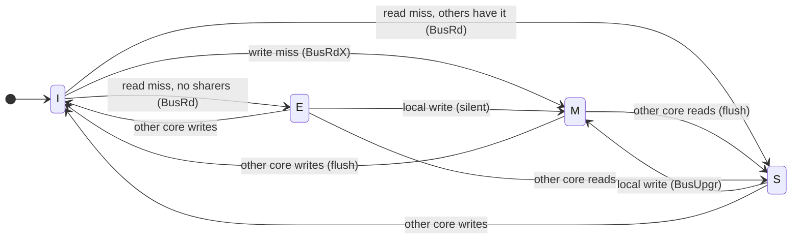

# MESI Snooping Cache Coherence

**Topic:** Chapter 5 (Thread-Level Parallelism) · **Editions:** multiprocessors from the 2nd, a leading
topic in the 4th-7th ·
**Files:** [`sv/mesi_snoopy.sv`](sv/mesi_snoopy.sv), [`vhdl/mesi_snoopy.vhd`](vhdl/mesi_snoopy.vhd)

## Background

When several cores keep private caches of shared memory, the same address can have several copies. A
**coherence protocol** keeps them consistent. In a **write-invalidate snooping** protocol every cache watches
(snoops) a shared bus; before a core writes a line, all other copies are invalidated, so there is only ever
one writable copy.

MESI adds an **Exclusive** state to plain MSI so that a core that is the only reader can later write
*without any bus transaction*:

| State | Valid | Dirty | Other copies | A write needs |
|-------|:-----:|:-----:|--------------|---------------|
| **M**odified  | yes | yes | none | nothing |
| **E**xclusive | yes | no  | none | nothing -- silently becomes M |
| **S**hared    | yes | no  | maybe | bus **upgrade** (invalidate the others) |
| **I**nvalid   | no  | -   | -    | bus **read-exclusive** |

Bus transactions: **BusRd** (read miss), **BusRdX** (write miss, wants ownership), **BusUpgr** (write to a
Shared line; no data needed).



## Design

* `P` cores (default 4) each hold one line's state + data word, plus one memory word. One line is enough to
  exhibit every protocol transition.
* A CPU operation is applied **atomically** in one clock (an idealized atomic bus); the bus transaction,
  supplied data and `writeback` flag are visible combinationally in that cycle, and states update at the edge.
* A Modified owner supplies the data on a read miss and **flushes it to memory** (`writeback = 1`), which also
  keeps "clean copies equal memory" true.
* Not modelled: split-transaction buses, races between simultaneous requests, and directories (Chapter 5
  covers all three).

## Verification

A directed scenario spells out every transition with the expected bus transaction, write-back and the four
resulting states:

| Op | Bus | Write-back | States C0..C3 |
|----|-----|:---:|---------------|
| C0 read            | BusRd  | - | E I I I |
| C0 write           | none (silent E->M) | - | M I I I |
| C1 read            | BusRd  | yes | S S I I |
| C1 write           | BusUpgr| - | I M I I |
| C1 write again     | none   | - | I M I I |
| C2 read            | BusRd  | yes | I S S I |
| C3 write           | BusRdX | - | I I I M |
| C0 write           | BusRdX | yes | M I I I |
| ...                | ...    | ... | ... |

It then runs **3 000 random reads/writes** from random cores. After every operation it checks two invariants
-- *at most one M/E copy, and if there is one nobody else holds a valid copy* (single-writer), and *every
clean copy equals memory* -- and every read must return the last value written (sequential consistency).

## Run it

```bash
make test T=mesi_snoopy
```

## Exercises

1. Add the **Owned** state (MOESI) so a dirty line can be shared without writing it back.
2. Extend to many lines with a tag array and count coherence misses on a producer/consumer pattern.
3. Replace the bus with a **directory** that tracks sharers and sends point-to-point invalidations.
4. Build a spin lock on top using an atomic read-modify-write and observe the invalidation traffic.
